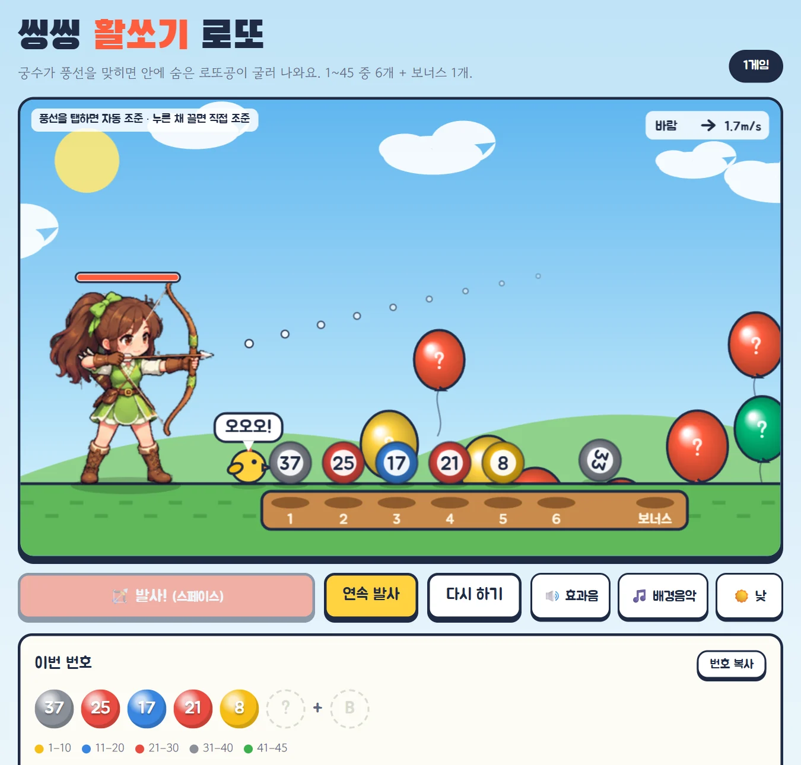
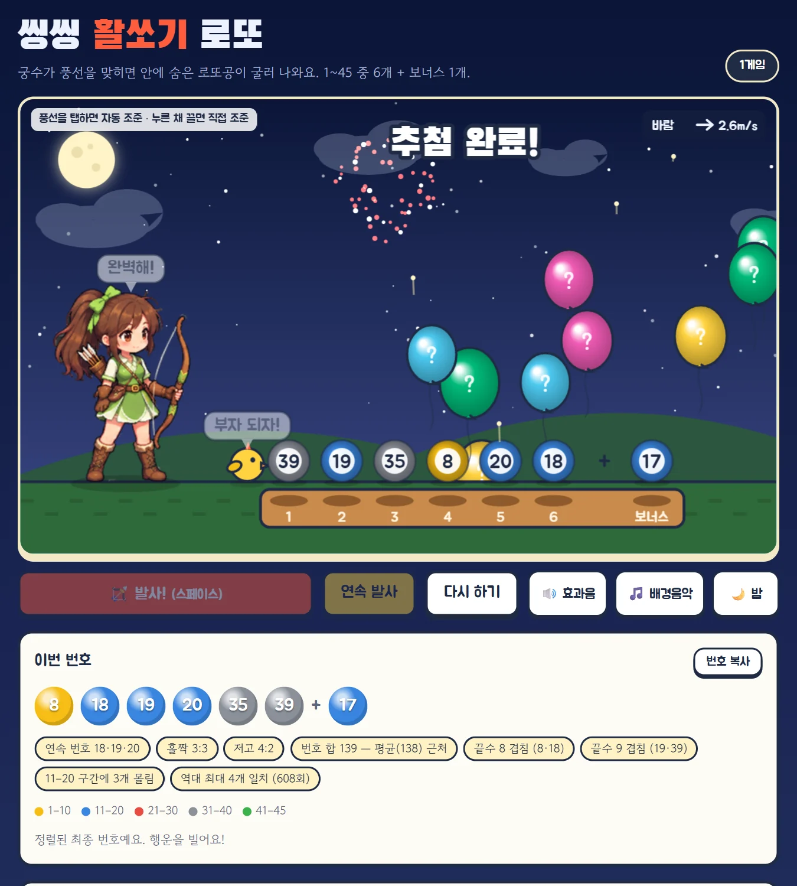

# 씽씽 활쏘기 로또

궁수가 풍선을 맞히면 안에 숨은 로또공이 굴러 나오는 로또 번호 뽑기 게임. Vite + React + TypeScript.



<table>
  <tr>
    <td width="50%"></td>
    <td width="50%"><br><br></td>
  </tr>
  <tr>
    <td align="center">밤 테마 · 폭죽 · 결과 코멘트</td>
    <td align="center">지난 회차 1등 번호와 같을 때</td>
  </tr>
</table>

## 기능

- **활쏘기 추첨**: 풍선을 탭하면 자동 조준, 누른 채 끌면 궤적을 보며 직접 조준. 번호는 조준과 무관하게 무작위(crypto)로 정해진다.
- **바람·낮/밤**: 바람이 풍선과 화살을 밀고, 밤에는 별·달·폭죽.
- **결과 코멘트**: 연속 번호, 홀짝, 번호 합, 끝수, 역대 당첨번호와 겹친 개수.
- **당첨 번호 확인**: 1회부터 최신 회차까지 실제 당첨번호로 지난 게임을 채점. 지난 회차 1·2등 번호와 같으면 축하 연출.
- **PWA**: 홈 화면에 추가해 앱처럼 쓰고, 오프라인에서도 실행.
- 효과음·배경음악은 음원 파일 없이 Web Audio 로 합성.

## 실행

```bash
npm install
npm run dev        # 개발 서버 (http://localhost:5173)
npm run build      # 당첨번호 갱신 후 dist/ 에 정적 파일 생성
npm run preview    # 빌드 결과 확인 (http://localhost:4173)
```

`dist/` 는 정적 파일이라 아무 웹 호스팅에 올리면 된다. 단, `file://` 로 더블클릭해서 열면 동작하지 않는다 (ES 모듈·서비스워커 제한).

## 당첨번호 데이터

- `public/data/draws.json` 에 전체 회차가 저장돼 있다. `npm run update-draws` 는 없는 회차만 받아 추가하며, `npm run build` 때 자동으로 실행된다.
- 앱은 이 파일을 먼저 읽고, 그 뒤에 나온 회차만 동행복권 API 를 브라우저에서 직접 한 번 호출해 `localStorage` 에 보관한다.
- 사용하는 API(`/lt645/selectPstLt645InfoNew.do`)는 공식 공개 API 가 아니라 결과 페이지 내부용이라 바뀔 수 있다.

## 구조

```
src/
├── game/          캔버스 게임 (React 와 무관)
│   ├── config.ts  화면 배치·물리·연출 상수
│   ├── engine.ts  게임 상태, 조준·발사, 한 프레임 업데이트
│   ├── render.ts  그리기
│   ├── weather.ts 바람, 구름, 별, 낮/밤
│   ├── audio.ts   효과음·배경음악 (Web Audio 합성, 음원 파일 없음)
│   └── util.ts
├── lotto/
│   ├── draws.ts   당첨번호 불러오기 (JSON + API 보충)
│   ├── rank.ts    등수 계산
│   └── analysis.ts 결과 코멘트
├── components/    Stage, Controls, Ticket, WinCheck, History, Ball
└── App.tsx
scripts/update-draws.mjs   당첨번호 JSON 갱신
legacy/                    React 이전 버전 (로컬 보관용, git 에는 올리지 않음)
```

## 라이선스

[MIT](LICENSE). 당첨번호 데이터의 출처는 동행복권이며, 이 프로젝트는 동행복권과 관련이 없습니다.
